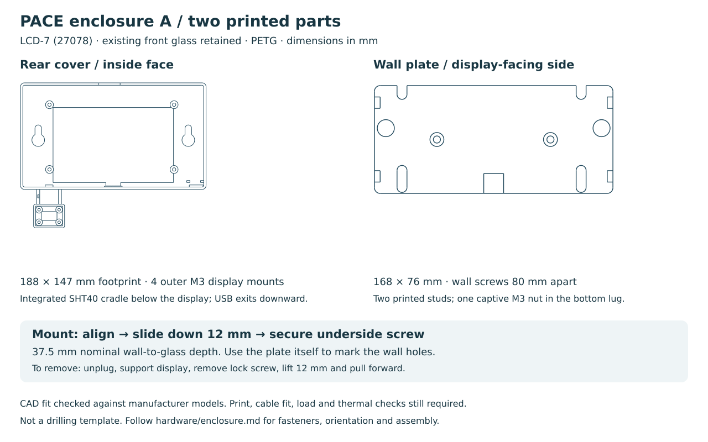

# Printed rear cover and concealed wall mount

The reference is **PACE enclosure A** for Waveshare **ESP32-S3-Touch-LCD-7, SKU 27078**. Keep the factory-bonded front glass and frame. Print two parts: a rear cover with an integrated sensor cradle, and a wall plate. Two headed studs on the plate engage the cover; slide the display down 12 mm and fit one underside locking screw. Removing that screw releases the display for service.



The nominal wall-to-glass depth is **37.5 mm**. The cover fits behind the 192.96 × 110.76 mm glass; its small sensor cradle sits below the right edge, separated by a 15 mm air gap. USB exits downward on the left. Left/right here refer to looking at the rear. This is a dry indoor assembly, with no ingress-protection rating.

**Mount the sensor below the display, not above it.** Warm air from the powered display rises; the lower, separate cradle reduces exposure to that heat. Keep the sensing opening and air gap clear, and avoid direct sunlight, radiators and drafts. The sensor's component side faces away from the wall as described below. Verify temperature accuracy after the complete assembly has stabilized; this placement does not guarantee an unbiased reading.

## Print

The repository includes the two ready-to-print STL files below. Print **one of each**. Units are millimetres; print at **100% scale** in the supplied orientation, with the flat rear faces on the bed. No CAD installation is needed to use these files.

| File                                 | Size, X × Y × Z     | Purpose                                     |
| ------------------------------------ | ------------------- | ------------------------------------------- |
| [rear-cover.stl](stl/rear-cover.stl) | 188 × 147 × 29.4 mm | Cover, sensor cradle and cable retention    |
| [wall-plate.stl](stl/wall-plate.stl) | 168 × 76 × 12.4 mm  | Concealed mounting plate and lift-off lock  |

Use **1.75 mm PETG**, a 0.4 mm nozzle, 0.2 mm layers, four perimeters, five top/bottom layers and 25% infill. Start with a 3 mm brim and no supports; inspect the slicer's layer preview, especially slot bridges and nut pockets. Use your filament maker's temperature settings within the printer's limits. These are starting settings, not a tested printer profile. Reserve 200 g for parts, brim and a retry.

Use a PETG-capable printer with a 200 × 200 mm bed. The largest footprint including the brim is 194 × 153 mm; keep clips and the purge line outside it.

## Assemble

Use the exact quantities and fastener standards in the [BOM](BOM.md#mounting-parts). Screw lengths are measured **under the head**.

1. Test electronics on the desk using [wiring](wiring.md). The [GUI orientation](../docs/development.md#device-setup) defaults to 180° for this cover; verify that text is upright and all four touch corners align before closing it. Disconnect power. Record the board revision and check its four outer M3 holes against the cover: 126.20 × 65.65 mm centers. Leave the inner PCB screws and glass assembly untouched.
2. Place the two M2.5 nuts in the cradle's diagonal hexagonal pockets. Fit the SHT40 with its components facing away from the wall, using two M2.5 × 8 screws. The other two posts support the board. Tighten gently; leave its sensing opening uncovered.
3. With the USB cable disconnected from its power source, plug it into the USB-to-UART socket and connect the sensor harness. Route USB down the left edge, and the QT lead through the bottom-right notch to the cradle. Retain both leads with small cable ties. Keep the four insulated harness joins together and away from the PCB, vents and mount slots.
4. Fit the cover with four M3 × 25 socket-head screws, without washers. The CAD provides **23.5 mm of post length and 1.5 mm of nominal thread engagement**. Check the received display's actual thread depth before tightening; stop if a screw bottoms out before the cover seats. Do not force the cover against the glass or flex cable.
5. Drop the M3 nut into the hexagonal opening on the **top edge of the bottom locking lug**. Push it down to its seat. The hexagonal well aligns the nut with the underside screw and prevents rotation. Keep the headed studs facing the display and the lug at the bottom.
6. Level the plate and mark its two wall holes, **80 mm apart**. For sound masonry/concrete, use two Fischer DuoPower 6 × 30 anchors with the supplied 4.5 × 40 countersunk screws. Follow [Fischer's installation dimensions](https://www.fischer-international.com/en/products/standard-fixings/plastic-fixings/duopower/534997-duopower-6-x-30-s-k-nv): 6 mm drill, at least 45 mm hole depth; clear drilling dust and check for hidden services. The plate is 4 mm thick. Thick plaster or an unsound substrate requires fixings that reach sound masonry; the short reference anchors are not qualified for that condition.
7. Support the display 12 mm above its final position, pass the stud heads through the wide openings, then slide it down. Insert the fifth M3 × 25 screw upward through the underside tab into the captive nut. Tighten by hand until snug. The wall screws stay hidden; no adhesive or second case is required.

For removal, unplug USB power, support the display, remove the underside screw, lift 12 mm and pull forward. The rear opening exposes BOOT/RESET and the board for service. Never pull on the sensor cradle.

## Fit boundaries and first-build checks

CAD checks establish model clearance, not manufacturing tolerances or strength. The USB allowance is a **27 × 12 × 8 mm straight plug body** beyond the socket, with a 6 mm cable turn radius. The selected cable supplier does not specify its mould dimensions: check the received plug and bend before closing the cover. Do not squeeze the cable to make it fit. The sensor harness is flexible and must be routed by hand.

Before fitting the electronics, check that the wall plate's studs slide freely into the cover's narrow slots and stay captured. Before mounting the powered display, verify screw engagement, nut fit, cable clearance and 12 mm removal travel. Perform the [FR-10 load and removal tests](../docs/requirements.md#functional-requirements) with a secured dummy load, no electronics and a protected surface below. Then check recovery access and stabilized sensor bias. This first-build check is not a certified load rating.

Current results and manufacturer-model hashes are recorded in [verification](../docs/verification.md#mechanical-cad-checks).

## Edit or regenerate the models

Optional: use [enclosure.py](enclosure.py) to change the geometry. From the repository root:

```sh
python3 -m venv .venv
.venv/bin/pip install cadquery==2.8.0 trimesh==5.1.1
.venv/bin/python hardware/enclosure.py
```

This updates `hardware/stl/` and prints validation results. Keep source and STLs together in geometry changes. Use `--output PATH` for a different STL directory or `--step-output /tmp/pace-step` for STEP exports. See [verification](../docs/verification.md#mechanical-cad-checks) for manufacturer-model checks.
