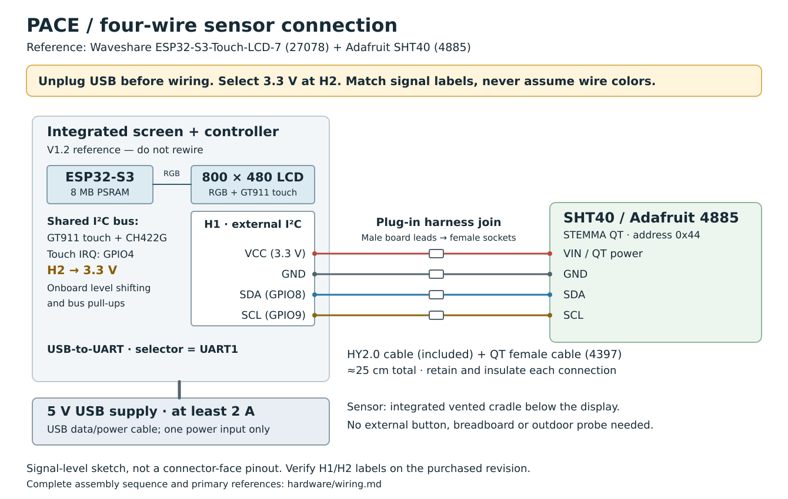

# Solderless wiring and first power-on

Connections for the [reference parts](BOM.md#electronics-and-cables): Waveshare LCD-7 with touch and Adafruit SHT40. Confirm the board revision before wiring; electrical/thermal results belong in [verification](../docs/verification.md).

## Four sensor connections

The LCD, touch panel, ESP32 and display support circuitry are already connected on the purchased module. Only the sensor harness and USB cable need external wiring.

**With power disconnected, set the board's I²C voltage selector H2 to 3.3 V.** Verify the labels on your revision; the reference V1.2 schematic identifies H1 as the external I²C connector and H2 as its supply selector. Do not connect a Qwiic cable directly to the different-pitch board socket.

| LCD module I²C signal  | SHT40 signal     | Purpose                                          |
| ---------------------- | ---------------- | ------------------------------------------------ |
| VCC, selected to 3.3 V | VIN via QT cable | Sensor power; its separate `3V` pad is an output |
| GND                    | GND              | Common reference                                 |
| SDA (GPIO8)            | SDA              | I²C data                                         |
| SCL (GPIO9)            | SCL              | I²C clock                                        |

Check continuity by **signal name**; connector order and wire colors are not guaranteed to match. The two cables below give a total length of about 25 cm.

To identify and join the cables, with USB unplugged:

1. **Board cable:** the supplied cable with one larger white HY2.0 four-pin plug and four separate exposed male pins. Insert its white plug into the board socket labeled **I2C**, not the three-pin **SENSOR** socket.
2. **Sensor cable:** Adafruit **4397**, with one small four-pin STEMMA QT/JST-SH plug and four separate black female sockets ([manufacturer photo](https://cdn-shop.adafruit.com/970x728/4397-02.jpg)). Insert its small plug into either QT socket on the SHT40. No soldered pin header is needed.
3. Push each board cable's male pin into the corresponding female socket: board **VCC → red**, **GND → black**, **SDA → blue**, **SCL → yellow**. These colors apply specifically to the [Adafruit 4397 cable](https://www.adafruit.com/product/4397); identify the board leads from its labels/continuity, not their colors. No extra jumper wires or breadboard are needed.
4. Seat all four joins fully, insulate any exposed metal individually, and secure the harness. Never force either white plug: the board and sensor connectors have different pitches.

The bus also serves the onboard touch controller and CH422G I/O expander. The SHT40 address 0x44 does not overlap the addresses documented for those devices. Start at 100 kHz and share one ESP-IDF bus instance. Both boards have pull-ups; do not add more without measuring rise time/sink current.

## Internal signals — do not rewire

| Function                       | Reference connection                                            |
| ------------------------------ | --------------------------------------------------------------- |
| I²C SDA / SCL                  | GPIO8 / GPIO9; also external sensor                             |
| Touch interrupt                | GPIO4                                                           |
| Touch reset / backlight enable | CH422G EXIO1 / EXIO2; not direct GPIO numbers                   |
| LCD data/clock/sync            | RGB D0–D15: GPIO14, 38, 18, 17, 10, 39, 0, 45, 48, 47, 21, 1, 2, 42, 41, 40; HSYNC GPIO46, VSYNC GPIO3, DE GPIO5, PCLK GPIO7 |
| Setup entry                    | On-screen deliberate settings gesture; no extra GPIO button     |
| Recovery                       | Existing BOOT/RESET buttons and USB-to-UART port                |

**GPIO21 is LCD data on this board; do not attach an external button there.** Do not apply the pin map of an ESP32 DevKit or another display model. BOOT shares a display signal and is for boot/recovery, not a runtime user-input button.

## Assembly order

1. With power off, record the PCB/panel markings and compare the connector labels with the reference above. If they differ, resolve the revision's pinout before connecting anything. Leave the sensor disconnected, select **UART1**, then connect the display's **USB TO UART** port to your computer with a data cable. Follow [flash instructions](../docs/development.md#flash-the-display).
2. Unplug USB. Set **H2 to 3.3 V**, prepare the [four-wire harness](#four-sensor-connections), and check continuity and shorts with a meter.
3. Keeping the sensor disconnected, power the board and measure VCC relative to GND: expect **3.3 V**. Unplug USB again, then attach the harness to the board and sensor. Insulate and secure the joins before restoring power.
4. Follow [device setup](../docs/development.md#device-setup) for Demo, bench tests and the enclosure. Keep the electronics accessible until bench checks pass.

Use one USB power input, supplied by the computer during development or the regulated mains USB adapter during normal use. Leave the onboard battery/CAN/RS485/SD connectors unused in the reference build. See [power design](../docs/architecture.md#power) for blanking and power-loss behavior. Never feed the bare sensor or MCU GPIOs with 5 V. The finished product needs no exposed mains wiring.

References: [board guide](https://docs.waveshare.com/ESP32-S3-Touch-LCD-7), [V1.2 schematic](https://files.waveshare.com/wiki/ESP32-S3-Touch-LCD-7/ESP32-S3-Touch-LCD-7-Sch.pdf), [sensor pinouts](https://learn.adafruit.com/adafruit-sht40-temperature-humidity-sensor/pinouts). Source: [pace_board.h](../firmware/components/pace_board/include/pace_board.h) and [board.c](../firmware/components/pace_board/board.c).
